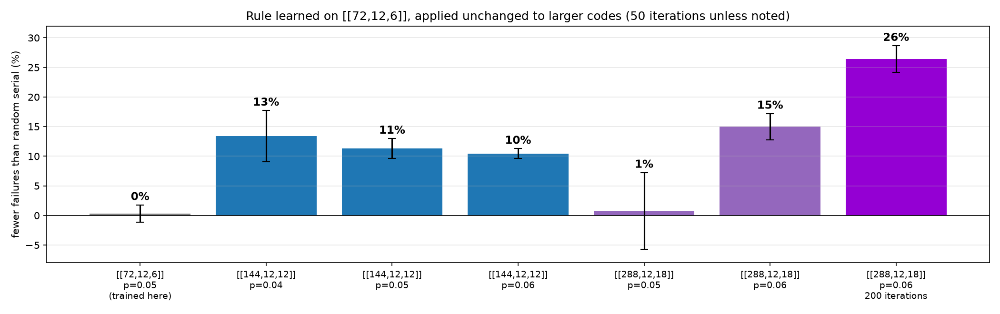
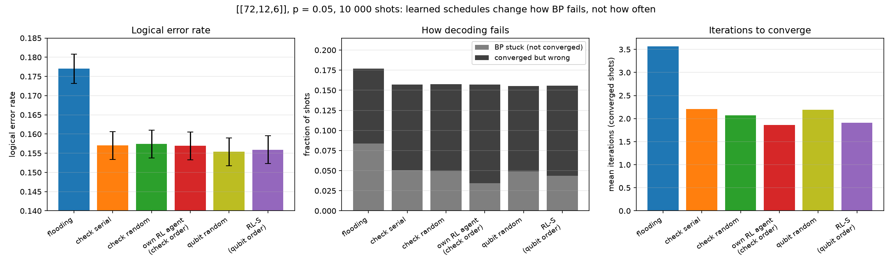
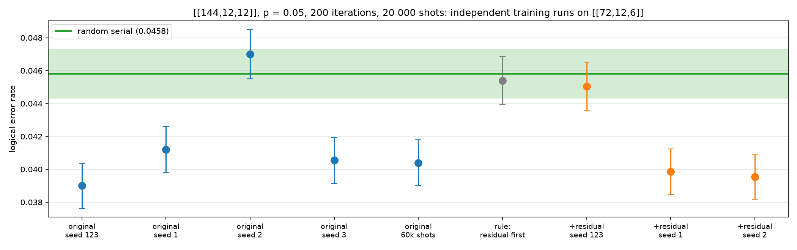

# Learning serial schedules for BP decoding of bivariate bicycle codes

Belief propagation (BP) is the standard fast decoder for quantum LDPC codes, but on these
codes it often fails to converge. In *serial* BP the checks are updated one at a time, and
the order of the updates changes the outcome. This project asks whether a reinforcement
learning (RL) agent can learn a better order. I implemented flooding, serial and random-serial
sum-product BP from scratch (checked shot for shot against the `ldpc` package [8]), showed that
the update order decides the outcome of about one shot in eight, and trained a linear
REINFORCE policy that picks the next check from five simple features. I also reproduced a
tabular Q-learning scheduler (RL-S [3]). **Main finding:** on the [[72,12,6]] code it was trained
on, the learned policy is no better than a random serial order: it trades stuck shots for
wrong answers. Applied unchanged to larger codes, though, the same policy gives 10–15% fewer
failures on [[144,12,12]] and up to 26% fewer on [[288,12,18]].

*Course project for Practical Quantum Computing 2026, topic 2: optimal serial schedules for
BP decoding using reinforcement learning. Author: Jussi Grönroos.*



## Background

Bivariate bicycle (BB) codes [1] are quantum LDPC codes built from two commuting polynomials
A(x, y) and B(x, y) on an l × m torus: H_X = [A | B], H_Z = [Bᵀ | Aᵀ]. Each check acts on 6
qubits and each qubit sits in 3 checks. They encode 12 logical qubits in 72, 144 or 288
physical qubits, at distance 6, 12 and 18. BP decodes by passing probability messages along
the Tanner graph of the parity-check matrix. It is exact on trees, but these Tanner graphs
have short cycles, so the messages reinforce their own errors and BP can oscillate or stall.
In flooding BP all checks update at once. In serial BP each check uses the newest messages
immediately, which cuts the iterations needed by about 40% here. Which check goes first is a free
choice, and on graphs with short cycles it changes the result. That makes the order a
natural target for dynamic scheduling [7] and for learning [3–6].

## Methods

- **Noise and failure:** code-capacity noise, meaning independent X errors with
  probability p on every data qubit and a perfect syndrome from H_Z. A shot fails if BP
  does not converge to the syndrome within the iteration limit, **or** if it converges but
  the residual error is a logical operator.
- **Decoder:** sum-product BP with prior log-likelihood log((1−p)/p), at most 50
  iterations at evaluation unless stated otherwise.
- **Schedules:**
  - *flooding*: all checks at once;
  - *serial*: checks in fixed index order;
  - *random serial*: a fresh random permutation every iteration;
  - *learned*: the policy below.
- **Learned policy (own):** within each iteration, every check is updated once. The next
  check is chosen by a softmax over a linear score w · f (greedy at evaluation). The
  features of each check are:
  - `unsatisfied`: the check is violated by the current hard decision;
  - `light_on`: its syndrome bit;
  - `uncertainty`: 1 / (1 + the smallest |LLR| among its qubits);
  - `wobbling`: the fraction of its qubits whose hard decision flipped this iteration;
  - `residual`: how much its messages would change if it were updated now, the quantity
    used in informed dynamic scheduling [7].
- **Training:** REINFORCE with 4 rollouts per syndrome and the mean reward of those
  rollouts as the baseline. Reward = success − 0.05 × iterations, at most 20 iterations,
  15 000 training syndromes on [[72,12,6]] at p = 0.05.
- **RL-S reproduction:** qubit-by-qubit ("vertical") serial BP. A qubit's state is the
  unsatisfied pattern of its 3 checks (8 states). A tabular Q(state, qubit) is learned by
  ε-greedy Q-learning: the reward is the drop in unsatisfied checks, plus 1 on success.
  Training uses 20 000 episodes at p ∈ {0.03, …, 0.07}. RL-S was introduced in
  arXiv:2603.10192; my implementation follows the description in arXiv:2607.20130 and
  arXiv:2607.24891 [3–5].

## Results

All numbers come from the files in [`results/`](results/). ± is one binomial standard
error. "+a/−b vs random" counts shots that random serial fails and the agent decodes (a),
and the reverse (b), on identical errors.

| Experiment | Setting | Result |
|---|---|---|
| **A.** Serial vs flooding | [[144,12,12]], p = 0.04, 2 000 shots | LER 0.0275 ± 0.0037 (flooding) → 0.0125 ± 0.0025 (serial); mean iterations 3.58 → 2.15 (−40%) |
| **B.** Does order matter? | [[72,12,6]], p = 0.05, 1 000 shots, 20 random orders | One random order: mean LER 0.152 (range 0.140–0.162). Best of the 20 orders per shot: 0.087. The outcome of 126 of 1 000 shots depends on the order |
| **C.** Learned agent on its training code | [[72,12,6]], p = 0.05, 10 000 shots | Random serial 0.1574 ± 0.0036, learned 0.1569 ± 0.0036 (+271/−266). Stuck shots 497 → 343, wrong answers 1 077 → 1 226 |
| **C.** RL-S reproduction | same | RL-S 0.1559 ± 0.0036; it does not beat its own qubit random-serial baseline (0.1554 ± 0.0036) |
| **Transfer** to [[144,12,12]] | p = 0.04 / 0.05 / 0.06, 20 000 shots | 0.0127 → 0.0110 (−13%, +78/−44); 0.0478 → 0.0424 (−11%, +187/−79); 0.1261 → 0.1129 (−10%, +350/−86) |
| | p = 0.05, 200 iterations | 0.0458 → 0.0390 (−15%, +201/−65) |
| **Transfer** to [[288,12,18]] | p = 0.05, 10 000 shots | 0.0130 → 0.0129: **no gain** (+36/−35) |
| | p = 0.06 | 0.0634 → 0.0539 (−15%, +148/−53) |
| | p = 0.06, 200 iterations | 0.0583 → 0.0429 (**−26%**, +165/−11) |
| **Robustness** | trained on [[72,12,6]] with other seeds, evaluated on [[144,12,12]], p = 0.05, 200 iterations, 20 000 shots | 4 of 5 training runs improve on random serial (one is a 60k-shot rerun of seed 123). With the residual feature, 2 of 3 runs do. Every working run has negative weights on both `uncertainty` and `unsatisfied` |



On [[72,12,6]] the learned schedules change *how* BP fails, not *how often*. The agent
rescues stuck shots, but about as many of them converge to a wrong logical class. On
[[72,12,6]] only 32% of random-serial failures are stuck shots (497 of 1 574). On
[[144,12,12]] (p = 0.05, 200 iterations) it is 79% (721 of 916), and on [[288,12,18]]
(p = 0.06, 200 iterations) 99% (579 of 583). The agent still trades stuck shots for wrong
answers there (144: 721 → 479 stuck, 195 → 301 wrong; 288: 579 → 412 stuck, 4 → 17 wrong),
but because stuck shots dominate, the trade now reduces the total. This is the likely
reason the policy transfers well despite not helping where it was trained.



Figures for Tasks A and B: [`figures/task_a.png`](figures/task_a.png),
[`figures/task_b_72_12_6.png`](figures/task_b_72_12_6.png).

## Limitations

- **Code-capacity noise only:** no measurement errors, no correlated errors [2] and no
  circuit-level noise.
- **A linear policy over five hand-made features:** the features are recomputed for every
  check after every update, so decoding with the agent is 3–10× slower than random serial BP
  in this Python implementation. From the `seconds` columns: 2.9× in `task_c_long.csv`
  (45 s vs 16 s), 5.9× in `night2_144.csv` (949 s vs 160 s), and 9.7× in `night2_288.csv`
  at p = 0.06 (1 174 s vs 121 s).
- **Finite shots:** the standard errors are about 0.0036 at 10 000 shots on [[72,12,6]],
  0.0014 at 20 000 shots on [[144,12,12]] and 0.002 at 10 000 shots on [[288,12,18]].
  Differences between schedules are judged with the paired rescued/lost counts on identical
  errors, which are much tighter than the unpaired errors suggest. The Task C difference
  (+271/−266) is not significant.
- **Training is not robust:** one of the five runs with the original features (seed 2) and
  one of three with the residual feature (seed 123) end no better than random serial.
- **No comparison with stronger decoders:** BP+OSD and other post-processing are not
  compared. The policy in the main results was trained on [[72,12,6]] at a single p.

## Known issues / future work

These are deliberately left unchanged, so that `results/` stays exactly reproducible:

- **Vertical BP iteration count:** `VerticalBeliefPropagation.decode` checks convergence
  before each qubit update. When decoding converges on the last qubit of iteration t, it
  reports t + 1. The `mean_iterations` of the `qubit_*` and `rl_s` rows are therefore
  slightly inflated and not exactly comparable with the check-based schedules.
- **REINFORCE design choices:** the summed log-policy gradient of a rollout is divided by
  its number of iterations, and the baseline (the mean reward of the 4 rollouts) includes
  the rollout's own reward. Both differ from textbook REINFORCE.
- **`BeliefPropagation.decode` edge cases:**
  - an unknown schedule name silently runs no updates;
  - `random_serial` without an `rng` raises an error;
  - `max_iterations = 0` raises a `NameError`.
- **Fragile agent rows:** `evaluate_agent` names agent rows by the weight-file path, and the
  plot scripts look up those exact strings.
- **Different RNG conventions:** the scripts handle the random serial order differently
  (shared vs per-shot generators); see [reproduce.md](reproduce.md#random-number-conventions).
- **Future work:** circuit-level noise, a non-linear policy, longer training directly on
  the larger codes (the short [[144,12,12]] runs in `overnight_144_*.csv` did not beat the
  policy trained on [[72,12,6]]), and the agent combined with OSD post-processing.

## Repository structure

```
src/
  codes.py        BB code construction (BB_CODES, build_code), GF(2) rank and kernel
  sim.py          error sampling, syndromes, failure test, decode_all_shots
  bp.py           sum-product BP: flooding, serial, random serial
  rl.py           learned-schedule decoder (features, softmax policy, gradient)
  vertical_bp.py  qubit-by-qubit BP and the RL-S Q-table policy
experiments/      one script per experiment (run_*, train_*, evaluate_*) and per figure (plot_*)
results/          every CSV, weight file and log behind the numbers above
figures/          figures generated from results/
tests/            pytest tests
reproduce.md      exact commands, in order, for every file in results/
```

## Install and quick start

Requires Python 3.14 (tested with 3.14.3).

```
python -m venv .venv
.venv\Scripts\activate              # Linux/macOS: source .venv/bin/activate
pip install -r requirements.txt
```

The quick start below runs in under a minute. Run all commands from the repository root:

```
python -m pytest
python -m experiments.compare_bp --shots 300
python -m experiments.evaluate_task_c --shots 300 --output quick_task_c.csv
python -m experiments.plot_transfer
```

The last command rebuilds `figures/transfer.png` from the stored results.

Every experiment script has `--help`, and its defaults are the settings used for the
results. [reproduce.md](reproduce.md) lists the full runs, in order, with runtimes (the
longest is about 3 hours).

## References

1. S. Bravyi, A. W. Cross, J. M. Gambetta, D. Maslov, P. Rall, T. J. Yoder, "High-threshold
   and low-overhead fault-tolerant quantum memory", Nature 627, 778–782 (2024),
   arXiv:2308.07915.
2. A. S. Maan, F. M. Garcia Herrero, A. Paler, V. Savin, "Decoding correlated errors in
   quantum LDPC codes", Nature Communications 17, 3965 (2026). doi:10.1038/s41467-026-70556-3
3. M. Moradi, V. Nourozi, S. Habib, D. G. M. Mitchell, "Learning to decode quantum LDPC
   codes via belief propagation", arXiv:2603.10192 (2026). Introduces RL-S.
4. M. Moradi, T. Kim, R. A. Chou, D. G. M. Mitchell, "Learning to decode quantum LDPC codes
   via cluster-based sequential belief propagation", arXiv:2607.20130 (2026). The RL-S
   state, reward and Q-learning update used here follow Sec. III, Eqs. 11–13 and
   Algs. 1–2.
5. M. Moradi, V. Nourozi, T. Kim, R. A. Chou, D. G. M. Mitchell, "High-performance
   reinforcement-learned BP decoding of quantum LDPC codes", arXiv:2607.24891 (2026).
6. M. Moradi, T. Kim, R. A. Chou, "Conflict-free color-clustered sequential
   belief-propagation decoding of quantum LDPC codes via reinforcement learning",
   arXiv:2609.20236 (2026).
7. T.-H. Huang, Y.-L. Ueng, "Informed dynamic scheduling for QLDPC codes", Quantum 10, 1967
   (2026).
8. J. Roffe, "LDPC: Python tools for low density parity check codes" (2022).

## License

MIT, see [LICENSE](LICENSE).
